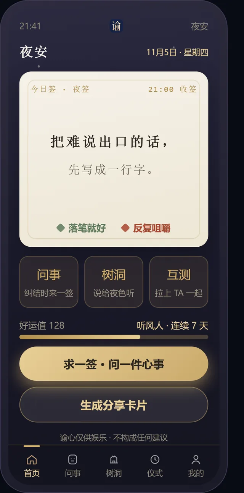
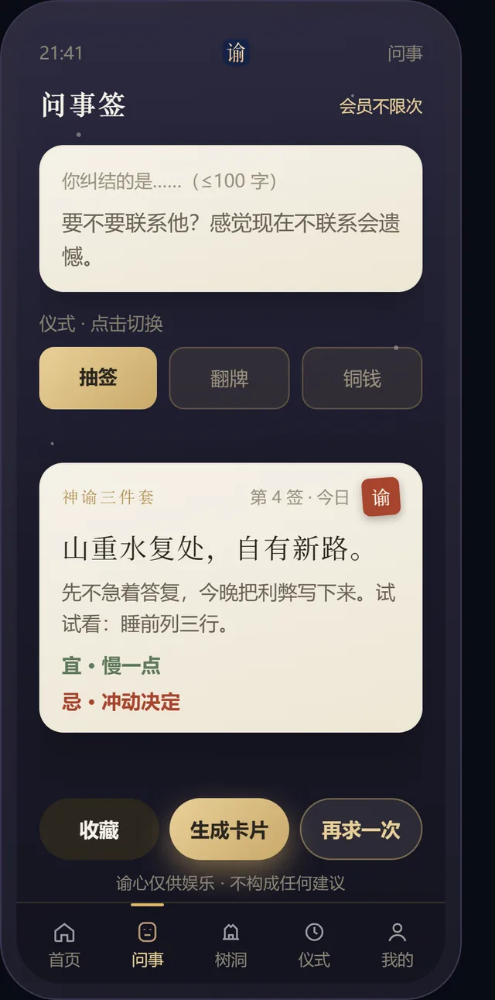
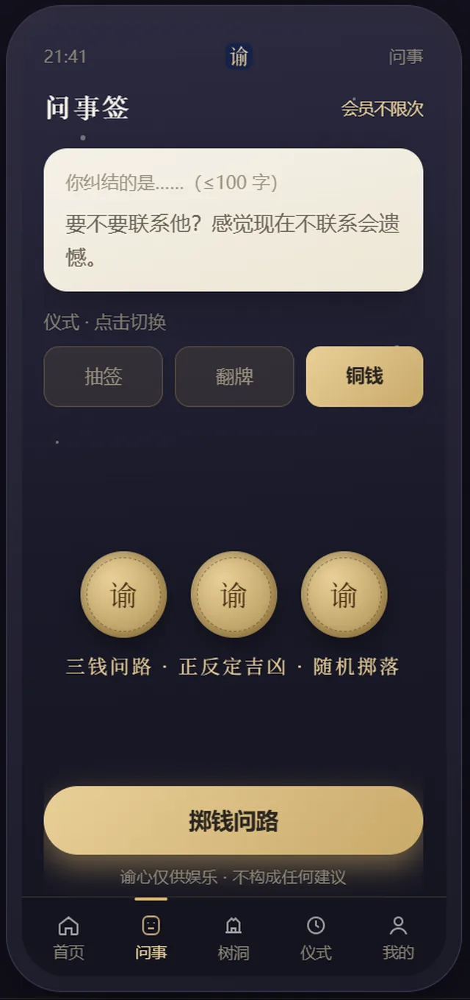
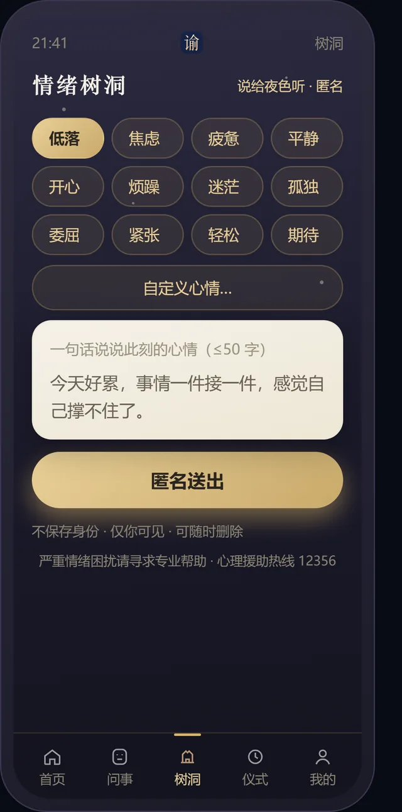
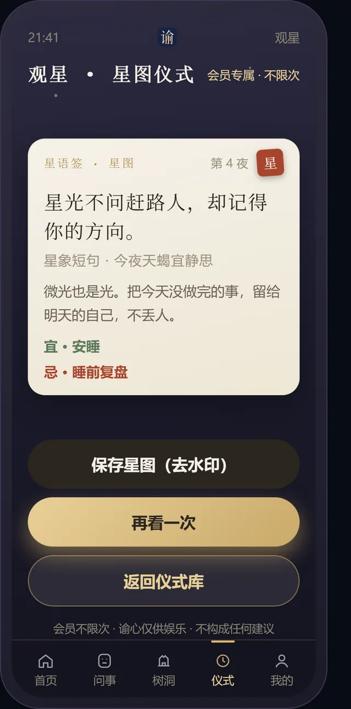
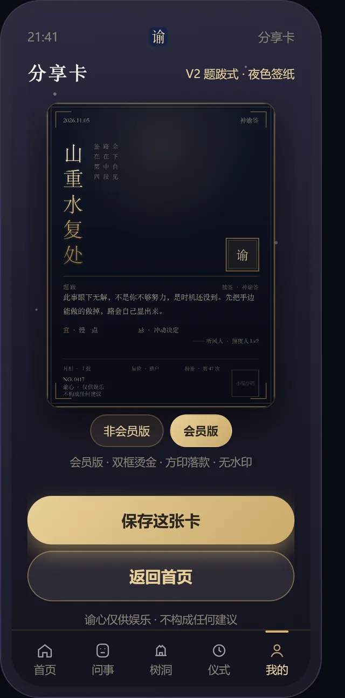
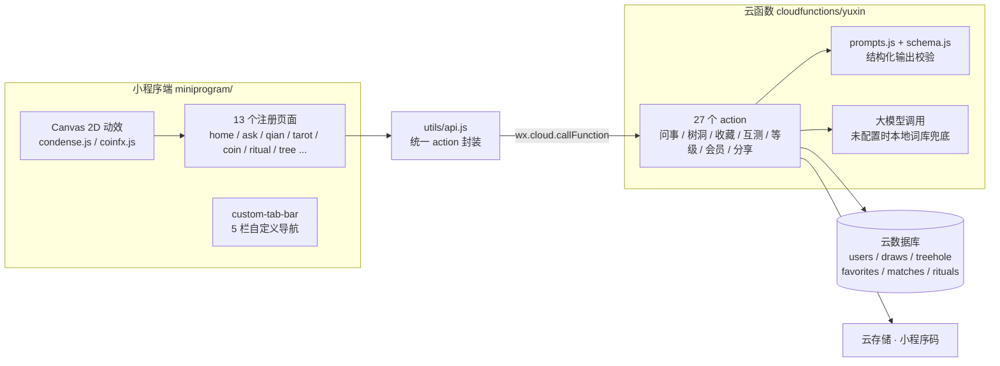

<p align="center">
  
</p>

<h1 align="center">谕心 YUXIN · 夜色神谕签筒</h1>

<p align="center">
  把「问一件事」做成一场夜间仪式的微信小程序
</p>

<p align="center">
  
  
  
  
  
</p>

<p align="center">
  <b>仅供娱乐 · 不构成任何建议</b>
</p>

---

## 这是什么

**谕心**是一款深夜气质的东方占卜小程序。当一件事悬在心里、说不清也放不下时，你可以：

- 在**问事**里选一种仪式——抽一支签、翻三张牌、掷三枚铜钱，写下心事，收下签文；
- 去**树洞**把难以启齿的话说给夜色听，还会收到一句「回声」；
- 点一炉**香**或看一场**星轨**，让情绪先落地；
- 把结果做成一张题跋式的**分享卡**，或拉上在意的人做一次**互测**。

界面采用深夜蓝金的设计语言：藏蓝夜空、香槟金线、米金签纸与宋楷标题。所有动效——签筒的光聚凝签、铜钱翻转、星轨流转——都由 **Canvas 2D 程序化绘制**，不依赖任何图片素材。

---

## 界面预览

<table>
  <tr>
    <td align="center"><br><sub>首页 · 今日签</sub></td>
    <td align="center"><br><sub>问事 · 抽签结果</sub></td>
    <td align="center"><br><sub>问事 · 掷铜钱</sub></td>
  </tr>
  <tr>
    <td align="center"><br><sub>树洞</sub></td>
    <td align="center"><br><sub>观星 · 星轨与星语</sub></td>
    <td align="center"><br><sub>分享卡 · 会员版</sub></td>
  </tr>
</table>

<p align="center"><sub>完整 25 张界面截图见 <a href="docs/images/screens/">docs/images/screens/</a>（640px 宽 WebP）</sub></p>

---

## 功能

### 每日签
每天 8:00 切换一支当日签，同一用户当天固定同一签文；签文由大模型生成，未配置模型时自动回落到内置词库。签纸可收进收藏。

### 问事三式
| 仪式 | 交互 | 动效 |
|---|---|---|
| 抽签 | 输入心事 → 光聚凝签 → 签文 | 写实竹制签筒入场、扫光、摇签、爆光、下沉离场 |
| 翻牌 | 选牌位 → 翻三张 → 牌面解读 | 牌阵翻面、金线描边 |
| 铜钱 | 品字三钱 → 四段式掷钱 → 卦象 | 铜钱抛掷、旋转、落定 |

### 树洞
匿名写下情绪与内容，云端保存；可收到其他用户留下的「回声」，也可删除自己的帖子。

### 仪式
- **焚香**：点香、燃香、香语结果三段状态；
- **观星**：星盘环、星座、流星与山影，生成星语；
- **仪式库**：沉淀全部仪式记录。

### 我的
等级体系（听风人 → 执灯人 → 观星人 → 掌印人 → 谕者）、好运值、连续天数、收藏、问事记录、会员开通、首次引导（称呼 / 生日 / MBTI）。

### 互测与分享
生成互测邀请，好友作答后给出契合度评分；结果可导出为分享卡（非会员带水印，会员版去水印并加金印）。

---

## 设计系统

| 项 | 值 |
|---|---|
| 夜空底色 | `#0b1226` → `#070d1c` 渐变 |
| 主金 | `#d8b46a` / `#e8c98a` / `#ffd98a` |
| 签纸米金 | `#f5ecd9` |
| 标题字 | 宋体 / 楷体书卷气质，字距舒展 |
| 正文字 | 无衬线，字号按 750rpx 体系折算 |
| 设计变量 | `styles/tokens.wxss` 共 **116 个变量 + 8 组 keyframes** |
| 样式真源 | `styles/tokens.json`（247 条规则，带 scope 与行号） |

页面与组件的 WXSS 统一走 `var(--token)`，颜色、圆角、间距不写死；`tools/audit.py` 会离线检查裸色值、裸 px 与变量闭合，无需启动模拟器。

---

## 技术架构



设计要点：

- **单函数多 action**：一个云函数承载 27 个业务动作，靠 `action` 字段分发，减少冷启动与部署成本；
- **AI 可降级**：`ai.isConfigured()` 判断模型是否就绪，失败时逐级回落到本地词库，保证无模型也能演示完整链路；
- **结构化输出**：`schema.normalize*` 对模型返回做字段校验与兜底，避免脏数据直接进数据库；
- **端侧零素材动效**：签筒、铜钱、星轨全部 Canvas 绘制，包体小、可随分辨率自适应。

---

## 目录结构

```text
yuxin/
├─ miniprogram/                    小程序前端
│  ├─ app.js / app.json / app.wxss 壳层：云开发初始化、自定义导航、5 个 tab
│  ├─ pages/                       21 个页面目录（13 个已注册）
│  │  ├─ home/                     首页 · 今日签
│  │  ├─ ask/ qian/ tarot/ coin/   问事入口与三种结果页
│  │  ├─ ritual/ incense/ star/    仪式 · 焚香 · 观星
│  │  ├─ tree/                     树洞
│  │  ├─ me/ fav/ records/ lv/     我的 · 收藏 · 记录 · 等级
│  │  ├─ share/ vipbuy/            分享卡 · 会员
│  │  └─ onboard/ intro/ mt/       引导 · 介绍 · 互测
│  ├─ custom-tab-bar/              自定义 tabBar（5 等分 + 金线）
│  ├─ styles/                      设计系统：tokens / base / shell / tabbar-icons
│  ├─ utils/                       api 封装、光聚凝签、铜钱动效
│  └─ components/                  pnav、navtag、navicon、cloudTipModal
├─ cloudfunctions/
│  ├─ yuxin/                       业务云函数（27 个 action）
│  └─ quickstartFunctions/         官方模板遗留，可安全删除
├─ tools/                          设计令牌抽取 / WXSS 生成 / 静态审计
├─ docs/                           视觉规格表、设计清单
│  └─ images/                      README 横幅 + 25 张 640px 界面截图
└─ project.config.json             微信开发者工具项目配置
```

---

## 快速开始

### 前置条件

- 微信开发者工具（稳定版）
- 一个已开通**云开发**的小程序 AppID
- Node.js（仅云函数依赖安装需要，也可选「云端安装依赖」）

### 1. 克隆并导入

```bash
git clone https://github.com/<your-name>/yuxin.git
```

用微信开发者工具「导入项目」，选择仓库根目录（`miniprogramRoot` 已指向 `miniprogram/`）。

> 仓库中的 `project.config.json` 使用占位 AppID `wx0000000000000000`，导入前请替换为自己的小程序 AppID（或在导入时选择测试号）。`cloudfunctions/yuxin/ai.js` 不再内置 API Key，需在云函数控制台配置环境变量 `DEEPSEEK_API_KEY`。

### 2. 配置云环境

打开 `miniprogram/app.js`，把 `globalData.env` 改成你自己的云环境 ID：

```js
globalData: {
  env: '<YOUR_CLOUD_ENV_ID>',
  ...
}
```

> 云开发控制台 → 设置 → 环境 ID。该值不要提交到公开仓库。

### 3. 部署云函数

右键 `cloudfunctions/yuxin` → **上传并部署：云端安装依赖**。依赖仅 `wx-server-sdk`。

### 4. 创建数据库集合

在云开发控制台创建以下 6 个集合（权限建议「仅创建者可读写」，`treehole` 的列表读取可在云函数内放开）：

| 集合 | 用途 |
|---|---|
| `users` | 用户资料、等级、好运值、会员状态、当日签缓存 |
| `draws` | 问事记录（签 / 牌 / 铜钱） |
| `treehole` | 树洞帖子与回声 |
| `favorites` | 收藏 |
| `matches` | 互测邀请与作答 |
| `rituals` | 仪式完成记录 |

首次进入小程序会自动 `user_init` 建档。

### 5. 可选：接入大模型

云函数内 `ai` 模块读取模型配置；未配置时全部走内置词库兜底，功能可完整体验。配置后，`prompts.js` 的提示词与 `schema.js` 的校验会自动生效。

### 6. 编译运行

点击「编译」，首次进入会走引导页（称呼 → 生日 → MBTI）。

---

## 云函数接口

<details>
<summary>展开 27 个 action</summary>

| action | 说明 | 主要集合 |
|---|---|---|
| `user_init` | 首次建档 / 读取用户 | users |
| `user_update` | 更新称呼、生日、星座、MBTI | users |
| `home` | 首页聚合数据（等级、好运、日期） | users |
| `daily_sign` | 当日签（8:00 切换，按日缓存） | users |
| `quota_check` | 问事次数校验 | draws |
| `draw_qian` | 抽签并落库 | draws / users |
| `draw_tarot` | 翻牌并落库 | draws / users |
| `draw_coin` | 掷铜钱并落库 | draws / users |
| `treehole_post` | 发布树洞 | treehole |
| `treehole_list` | 树洞列表 | treehole |
| `treehole_delete` | 删除自己的帖子 | treehole |
| `echo_list` | 获取回声 | treehole |
| `fav_list` / `fav_add` / `fav_delete` | 收藏增删查 | favorites |
| `match_create` | 创建互测 | matches |
| `match_score` | 双方作答后评分 | matches |
| `match_list` | 我的互测列表 | matches |
| `friend_view` / `friend_answer` | 好友查看 / 作答 | matches |
| `level_info` | 等级与好运值 | users |
| `ritual_complete` | 仪式完成 + 好运值 | rituals / users |
| `ritual_ai` | 焚香 / 观星文案生成 | rituals |
| `ritual_list` | 仪式记录 | rituals |
| `vip_status` / `vip_order` | 会员状态 / 下单 | users |
| `share_card` | 分享卡数据 | draws |
| `qrcode_get` | 生成小程序码 | — |

</details>

---

## 工程与自检

项目把「设计稿 → 小程序」的转换做成了可复现的流水线：

```text
设计稿 CSS ──extract_tokens.py──▶ tokens.json ──gen_wxss.py──▶ tokens.wxss / base.wxss
                                                   │
                             gen_tab_icons.py ─────┤
                             build_spec.py ────────▶ docs/A2-视觉规格表.html
                                                   │
                                   audit.py ───────▶ docs/.audit.txt
```

无需模拟器的静态审计：

```bash
python tools/audit.py
```

输出页面数、WXSS 数、token 数、变量引用、裸色值 / 裸 px 与缺失变量。当前 `ask` 页仍有少量直接色值与一处 px 未收敛，属已知待办。

另有像素级回归口径：以 25 张 984×1986 基准图为参照，同一路径逐页比对，单页差异像素目标 < 2%。

---

## Roadmap

- [ ] 分享卡 Canvas 2D 导出（会员版去水印 + 金印）
- [ ] 次数用尽空态、低端机粒子降级（`benchmarkLevel < 20` 减半）
- [ ] 翻牌界面按夜色蓝金语言重绘
- [ ] 真机回归：`textarea` 同层渲染占位层、动画 60fps
- [ ] iOS 虚拟商品支付方案（会员购买合规）
- [ ] 清理官方模板遗留页（`pages/index`、`pages/example`、`quickstartFunctions`）

---

## 合规说明

- 占卜内容**仅供娱乐**，全站保留「不构成任何建议」声明，不提供医疗、投资、法律等专业判断；
- 会员属于虚拟商品，iOS 端需遵守平台最新虚拟支付规则；
- 树洞内容应配合敏感词与举报机制，上线前请按平台规范补充。

---

## License

仓库暂未声明开源协议。在补充 `LICENSE` 前，代码仅供学习与参考，请勿直接商用或二次分发；界面设计与文案版权归项目作者所有。

如需开源，推荐 **MIT**（代码）或 **CC BY-NC 4.0**（代码 + 设计资产），按你的意愿在仓库根目录添加即可。

---

<p align="center"><sub>夜色很深，先把心事写下来。</sub></p>
